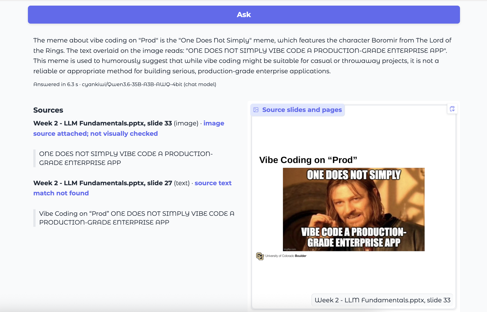
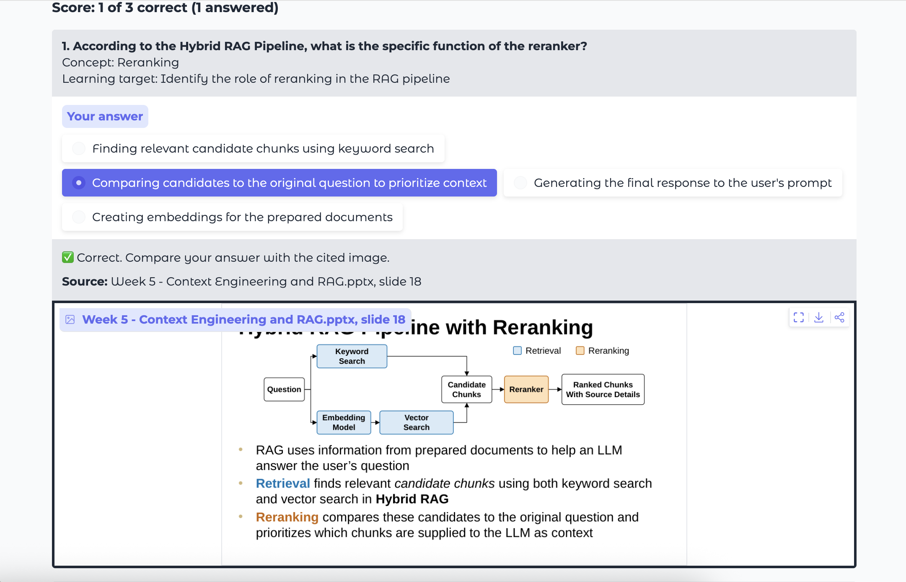
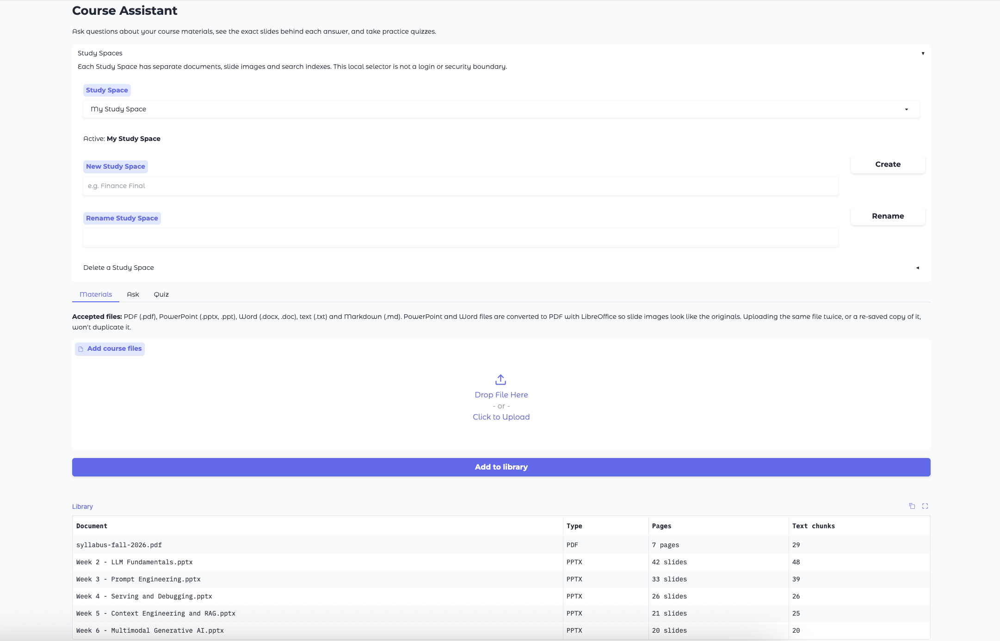
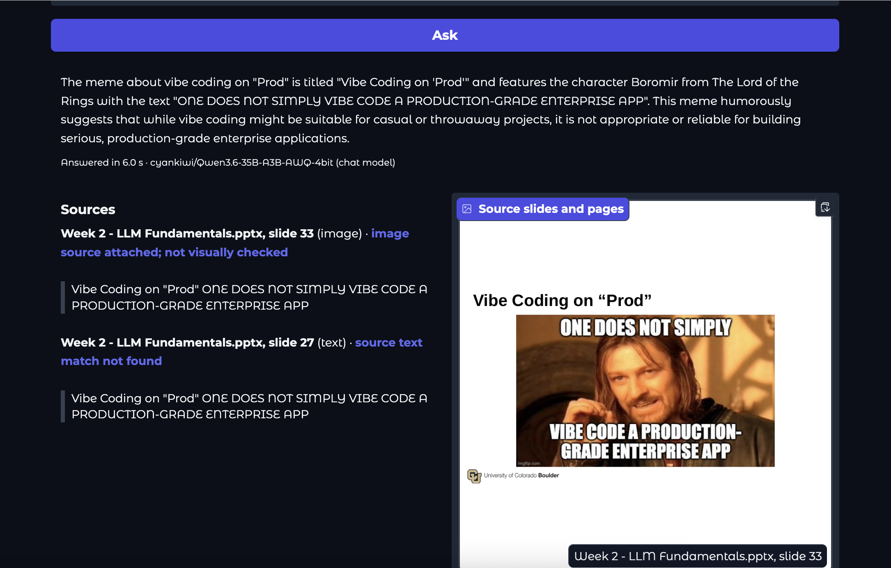
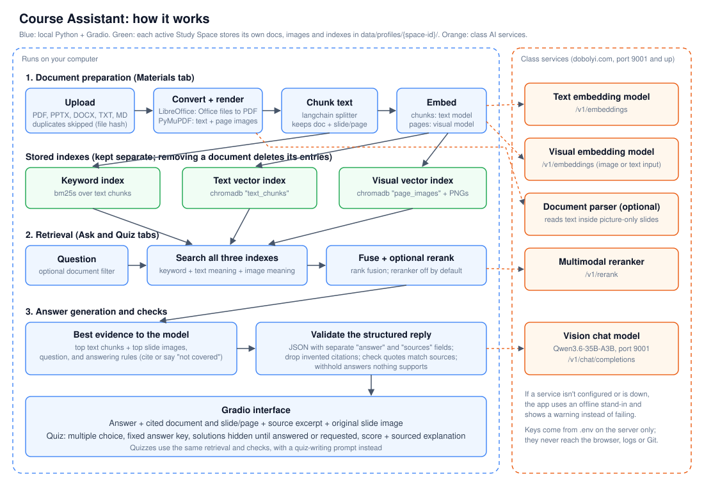

# Course Assistant (MBAX 6418, Assignment 2)

A Python app that answers questions about the course materials and makes practice quizzes. It searches the slides by keyword, by meaning, and by what the slide images look like (hybrid RAG). It shows the actual slide behind every answer, and it says so when the materials don't cover a question.

> **Status: tested against the class AI services.**
> The first version was built and tested offline, with built-in stand-ins instead of the class models. Anything below marked "offline" still describes those runs. Since then, all five class services have been connected: on a Windows laptop (2026-10-08 and 2026-10-09) for the evaluation questions, a reranking on/off comparison and a quiz check, and on a Mac for adding and removing materials and for Study Spaces and Quiz 2.0 (2026-10-12). The embedding and reranker request formats were also confirmed with live tests. See [What was tested and what wasn't](#what-was-tested-and-what-wasnt).

Other project docs: [PLAN.md](PLAN.md) (build plan and issues), [docs/assignment-summary.md](docs/assignment-summary.md), [docs/decisions.md](docs/decisions.md), [docs/course-materials.md](docs/course-materials.md).

## Screenshots

Taken by Kristen on 2026-10-15 from the final app (`main` plus PRs #22 and #23), with all five class services connected and the five course decks plus the syllabus loaded. The browser toolbar was cropped out.

**An answer with its supporting slide image.** The question "Find the meme about vibe coding on "Prod" and explain it" was asked across all documents, with no document filter. The class chat model described the meme and cited Week 2 slide 33, and the original slide is shown next to the answer. The app also listed slide 27 as a source but marked it "source text match not found", so the reader can see that citation wasn't confirmed:



**Quiz feedback with sources.** A 3-question Quiz 2.0 quiz on the Week 5 deck with the topic "reranking", written by the class chat model. Each question shows its concept and learning target. The answer stays hidden until you click **Check answer** or **Show answer**. After checking, the feedback shows whether you were right, the source (Week 5 slide 18) and the original slide image:



**The Materials tab with Study Spaces.** The active Study Space and the six documents in its library:



**Dark mode.** The same meme question in dark mode. Text and controls stay readable, and slide images keep their white background:



Earlier screenshots, taken 2026-10-09 before Study Spaces and Quiz 2.0 were merged, are kept for reference: [answer](docs/images/answer-with-slide-live.png), [quiz feedback](docs/images/quiz-feedback-live.png), [quiz feedback in dark mode](docs/images/quiz-feedback-dark-live.png).

An offline demo of the current interface, made on 2026-10-15 with a small generated PDF instead of the course decks and without the class services, shows the same screens: [Study Spaces and Materials](docs/images/study-spaces-current-offline.png), [Ask](docs/images/ask-current-offline.png), [Quiz](docs/images/quiz-2-current-offline.png).

## Setup

### 1. Install the software

You need:
- **Python 3.11 or newer**: [python.org/downloads](https://www.python.org/downloads/)
- **LibreOffice** (free), to read PowerPoint and Word files: [libreoffice.org/download](https://www.libreoffice.org/download/)
  - On a Mac, the easiest install is [Homebrew](https://brew.sh): `brew install --cask libreoffice`. Installing from the website works too: the app looks in `/Applications/LibreOffice.app` automatically, so you don't need to set `SOFFICE_PATH`.
  - On Windows, install from the website. The app finds it in `C:\Program Files\LibreOffice` automatically.
  - Installed somewhere else? Set `SOFFICE_PATH` in `.env` (step 3) to the full path of `soffice`.
  - Tested with LibreOffice 26.8 on a Mac.
  - Without LibreOffice, PDF, TXT and Markdown still work. Uploading a PowerPoint or Word file shows "LibreOffice is needed to read PowerPoint and Word files, but it isn't installed." Install it, or export the file to PDF (in PowerPoint: **File > Export > PDF**) and upload the PDF instead.

### 2. Get the code and install the Python packages

```bash
git clone https://github.com/burnt-ham/assignment-2.git
cd assignment-2
python3 -m venv .venv
source .venv/bin/activate          # Windows: .venv\Scripts\activate
pip install -r requirements.txt
```

### 3. Connect the class services

```bash
cp .env.example .env               # Windows: copy .env.example .env
```

Open `.env` in a text editor and fill in the class key, plus the address and model name of each class service. The file has a comment for each line.

- `.env` is ignored by git, so your key stays on your computer. **Never put a real key in `.env.example`, the README, screenshots or anything else that gets committed.**
- Any service you leave blank uses an offline stand-in, so the app always starts. The Materials tab shows which services are in use under **AI services in use**.
- The chat model's address and name come from the Week 4 slides. The embedding, reranking and document-parsing services are on ports 9001 and up; get their ports and model names from the class.

### 4. Start the app

```bash
python app.py
```

Open http://127.0.0.1:7860 in your browser. To stop it, press Ctrl+C in the terminal.

## Using the app

**Study Spaces:** use the selector above the tabs to create, switch, rename or delete a study context (for example, MBAX 6418 and Finance Final). Each space has its own document library, rendered slide images, keyword index and text/visual vector indexes. Uploading the same file to two different spaces is allowed; duplicates are checked within one space. Switching spaces clears the current answers and quiz from the page, and Ask and Quiz use only the active space's documents. To delete a space, switch to a different one and select the inactive space in the deletion control. Deletion permanently removes its stored documents and indexes; the last space cannot be deleted. This is a single-user, app-wide selector, **not** separate accounts, access control, or a security boundary. Avoid running multiple users in the same app process, since changing the active space changes it for everyone.

**Existing installations:** on first launch, the old `data/library.json`, `data/docs/` and `data/chroma/` are copied into a fresh default **My Study Space**, including updated slide-image paths. The originals are kept in place as a recovery copy; do not delete them until you have checked the migrated library and backups yourself. Stop the old app before upgrading so its index files are not being written during copying. If `data/profiles/default/` exists but `data/profiles.json` does not (for example, after an interrupted migration), startup stops without overwriting either copy. Inspect and back up both locations before removing or repairing the incomplete destination; do not remove the legacy originals as a workaround. Later uploads stay in the active space and do not reset other spaces. The registry is `data/profiles.json`; each space's files live under `data/profiles/{space-id}/`. Future quiz history can live in the same folder.

**Materials tab:** choose one or more files and click **Add to library**. Large decks take a while; the 42-slide Week 2 deck took about 70 seconds to convert. Uploading a file that's already there does nothing, even under a different file name. To remove a document, pick it in **Remove a document** and click **Remove**. On success, its text, slide images and search entries are deleted, so later answers can't use it. If file cleanup fails after removal from the library, the app reports an error; the remaining files need manual cleanup.

**Ask tab:** type a question and click **Ask**. You can limit the search to certain documents. The answer shows:
- the sources, each with its document and slide or page, and whether source text or words matched the quote or an image source was attached; matching is sometimes approximate and does **not** fact-check the answer or visually verify an image
- the original slide or page images
- under **All evidence the model saw**, everything the search found, with scores

If nothing in the materials supports an answer, the app says so instead of guessing.

**Quiz tab:** pick documents, optionally type a topic, choose how many questions, and click **Make quiz**. The button immediately shows generation progress and is disabled until the quiz succeeds or fails. For each question, pick an answer and click **Check answer**, or click **Show answer** to see it without scoring. The score counts only checked answers. The answer key is fixed when the quiz is made; feedback shows the cited passage or slide.

### Quiz 2.0: how questions are written and checked

Model-written questions now carry a reusable **concept** and a specific **learning target**, shown beside each question; the quiz header summarizes concept coverage. A topic filters retrieval, while an unfocused quiz draws evidence across selected documents and across each long document. Creation checks source IDs and text quotes, four nonblank choices distinct after case/whitespace normalization, course-section labels masquerading as concepts, and generic all/none options. A second model pass sees the questions, choices and cited evidence **without the writer's answer key or explanation**; it must choose one supported answer and provide a source phrase. Disagreement, ambiguity, invalid checks or unsupported quotes reject the question. Accepted questions show the checked source excerpt instead of an unverified writer explanation. Choices are displayed as written, so scientific names and programming syntax are not silently changed. Rejected or repeated questions trigger up to two bounded replacement batches rather than silently shrinking the quiz. If none pass, or the service fails, the app uses simpler source-based term-recall questions; previously accepted questions remain if replacement fails. Service error details are not shown to students.

**Quality limit:** a second pass using the same model is corroboration, not proof: it can agree with a wrong key, cite an unrelated phrase, or be misled by instructions embedded in course material. Learners do not have to validate answers to use the quiz; the team should still periodically evaluate real model output against its source material. Before this second pass was added, Kristen checked 15 Quiz 2.0 questions from the class chat model by hand: every quote appeared in its cited source and every answer key was correct. Persistent question banks, attempts, study statuses, adaptive review and Study Space-scoped history are later Quiz 2.0 work, not part of this creation slice.

### Supported files

| Type | How it's read | Needs LibreOffice |
|---|---|---|
| PDF (.pdf) | Text from each page, plus an image of each page | No |
| PowerPoint (.pptx, .ppt) | Converted to PDF with LibreOffice, then read like a PDF, one image per slide | Yes |
| Word (.docx, .doc) | Converted to PDF with LibreOffice, then read like a PDF, one image per page | Yes |
| Markdown (.md) | Split into sections at its headings (`#`, `##`, …); no images | No |
| Text (.txt) | Read as one section; no images | No |

The app lists these under **Accepted files** on the Materials tab, and refuses any other file with a message naming the supported types. Each format above was checked by adding a sample file (Mac, LibreOffice 26.8). Other files need converting first: Keynote and Google Slides decks can be exported to PowerPoint or PDF, and images or screenshots can be pasted into a document and saved as PDF.

Speaker notes in PowerPoint files are not read. Repeated headers and footers (like "Syllabus (Subject to Change) 3") are removed from page text so they don't clutter search results.

**Duplicates** are caught two ways. An identical file is refused at once by its SHA-256 hash. A copy that was re-saved or re-exported (different bytes, same slides) is refused after it's read: every page must have the same text, and its image must look the same on a 16 x 16 brightness grid. The decks in `materials/` were re-saved when the class key was removed, so they differ byte-for-byte from the Canvas downloads, and the second check is what catches those. A deck with the same text but a changed picture or chart is still added as new.

**Animated GIFs** in PowerPoint files are replaced with a still image before conversion. LibreOffice drew some large GIFs as an empty box, so the app keeps the GIF's most detailed frame instead (see Limitations). Videos show their preview image.

**Links in slide text** are turned into plain text drawn the same way (link colour, underlined) before conversion. LibreOffice treats linked text as one unbreakable piece, so a long link wrapped mid-word: Week 2 slide 7 showed "Artificial Analysis I / ntelligence Index", and the split word also reached the searchable text. Slide images can't be clicked, so nothing is lost. Found by a manual spot check against the original slides.

**Checking the conversions:** all 42 Week 2 slides were compared, pixel by pixel, with a PDF exported from PowerPoint itself. 41 matched closely; the 42nd (slide 37, a GIF) was blank until the fix above. Slide 33, the meme, matches the original. All 12 GIF slides across the decks were then checked by eye. Kristen also spot-checked the app's slide images against the original slides by eye: Week 2 slides 4, 7, 31 and 33, and Week 5 slide 11. All matched except slide 7, where a long link wrapped mid-word; that is fixed (see Links in slide text above).

## How it works



| Step | What happens | Code | Runs on |
|---|---|---|---|
| Document preparation | Upload, skip duplicates (same file bytes, or the same pages in a re-saved copy), convert Office files with LibreOffice, extract text and render page images with PyMuPDF, split text into chunks that keep the document and slide number | `course_assistant/ingest.py`, `library.py` | Your computer |
| Indexes | Keyword index (bm25s), text vector index and a separate image vector index (chromadb), all saved in `data/` | `library.py` | Your computer |
| Embeddings | Text chunks go to the text embedding model; page images go to the visual embedding model | `services.py` | Class services |
| Retrieval | Search all three indexes, combine the results with reciprocal rank fusion, then, if reranking is on, rerank with the multimodal reranker | `retrieval.py` | Your computer + class reranker |
| Answer generation | Send the best text chunks and slide images to the vision chat model with answering rules; it must reply in JSON with separate `answer` and `sources` fields | `answering.py` | Class chat model |
| Checks | Validate the JSON (with one retry), drop citations to evidence that wasn't supplied, check each quote appears in its source, and withhold answers nothing supports | `answering.py` | Your computer |
| Quizzes | Same retrieval, a quiz-writing prompt, then checks for 4 distinct options, one valid correct answer, and a real supporting quote | `quiz.py` | Your computer + class chat model |
| Interface | Gradio app with a Study Space selector and Materials, Ask and Quiz tabs | `app.py` | Your computer |

Reranking **defaults to off** (`USE_RERANK=false` in `.env`). Our comparison found it didn't improve answers or citations on our questions and made each answer about 2.5 times slower (see [Evaluation](#evaluation)). To use it, set `USE_RERANK=true`, or tick **Rerank results with the class multimodal reranker** on the Ask tab for a single question.

**Offline stand-ins** (`services.py`) take over when a service isn't configured or doesn't respond: word-count vectors instead of text embeddings, page text instead of real image embeddings, word overlap instead of the reranker, and quoted passages instead of written answers. Quizzes fall back to fill-in-the-blank questions. The app shows a warning when this happens.

**Keys:** read only from `.env` or environment variables on the computer running the app. They are sent only to the class services, and are removed from any error message before it is shown or logged (`config.py: redact`).

## Tests

```bash
python -m pytest
```

163 automated tests. All but 3 need no internet or class services, because they use fake AI services and local sample files. The 3 tests in `tests/test_services_live.py` call the real class services only when `.env` points at them. GitHub Actions runs the offline suite on Python 3.11 and 3.12 with LibreOffice installed; it does not supply class-service credentials, so a green run checks the offline workflows, not live answer quality.

**Fresh-clone check (public `main`, 2026-10-15):** in a separate clean directory on Windows, Python 3.12 created a new virtual environment, installed `requirements.txt` successfully (`pip check` found no broken requirements), and ran **138 passed, 8 skipped** without credentials. The app returned HTTP 200 on localhost; a separate offline smoke flow added a Markdown sample, answered with a citation, made a one-question quiz and graded it 1/1. LibreOffice was not installed on that machine, so this does not establish Office conversion or live class-service behavior. This check was independent of the uncommitted changes and does not replace another teammate's final review.

- **Unit tests** (`tests/test_ingest.py`, `test_library.py`, `test_retrieval.py`, `test_answering.py`, `test_quiz.py`, `test_quiz_ui.py`, `test_ui_rendering.py`, `test_config.py`) check individual parts: reading PDF, Markdown and PowerPoint files, chunking with source details, duplicate detection, removal, rank fusion, JSON parsing, quote checks, dropping invented citations, quiz validation, scoring, the fixed answer key, and that keys never appear in error messages.
- **End-to-end tests** (`tests/test_end_to_end.py`) run complete workflows: add files, repeat an upload, ask text and image questions, make and score a quiz, remove a document and confirm answers no longer use it, questions the materials can't answer, and the chat model and reranker both being down.
- **Study Space tests** (`tests/test_study_spaces.py`) check isolated uploads/search across spaces, migration with page images, UI controls, deletion, renaming and restart persistence.

The 4 PowerPoint conversion tests are skipped automatically if LibreOffice isn't installed.

## Evaluation

The question set is in [eval/questions.json](eval/questions.json): five text questions (syllabus and slides), two visual questions (the Week 2 meme and the Week 5 hybrid RAG diagram), and one question the materials can't answer.

| ID | Question | Type | Expected source |
|---|---|---|---|
| Q1 | When are the professor's office hours? | text | Syllabus p.1 |
| Q2 | How much of the final grade is the final project worth? | text | Syllabus p.2 |
| Q3 | What is the penalty for turning in an assignment late? | text | Syllabus p.2-3 |
| Q4 | What is KV caching, and what is its tradeoff? | text | Week 2 slide 11 |
| Q5 | In a hybrid RAG pipeline, what does reranking do? | text | Week 5 slide 18 |
| Q6 | Find the meme about Vibe Coding on "Prod" in the Week 2 slides. What do its image and text show? | visual | Week 2 slide 33 |
| Q7 | Describe the diagram of the hybrid RAG pipeline with reranking from the Week 5 slides. | visual | Week 5 slide 18 |
| Q8 | How much does a parking permit for the Koelbel building cost? | not answerable | none |

**Design comparison:** reranking on vs. off, with the same questions, the same files and hybrid search in both settings. The script can also compare hybrid search (keyword + text + image) with embeddings only. To run a comparison, start the app once, add all five decks and the syllabus PDF, stop the app, then run:

```bash
python scripts/evaluate.py --compare rerank   # reranking on vs. off (the comparison reported below)
python scripts/evaluate.py                    # hybrid vs. embeddings only
```

Results are saved in `eval/results/` as JSON, CSV and a Markdown table. The script checks each answer automatically: the expected source was cited, the answer contains an expected keyword, and an unanswerable question was declined. It also records the time taken. Then read every answer and fill in the **Correct (team check)** column yourselves, because the automatic check is only a first pass.

### Results: reranking on vs. off (class services)

We ran the comparison three times on 2026-10-08 with all five class services connected. The full tables and per-question notes are in [eval/results/live-rerank-summary.md](eval/results/live-rerank-summary.md). Junkyu graded every answer from run 3 by hand against its expected answer. The **correct** column asks whether the answer is right. The **sources** column asks whether every cited source supports it.

| Setting | Automatic check, runs 1-3 (keyword + expected page only) | Team check, run 3: correct | Team check, run 3: sources | Average time per question |
|---|---|---|---|---|
| Reranking on | 8/8, 8/8, 8/8 | 7/8 | 6/8 | 5.3 s |
| Reranking off | 8/8, 8/8, 8/8 | 8/8 | 7/8 | 2.1 s |

Where the team check differed from the automatic check:
- **Extra, unrelated citations.** Reranking on: Q2 (syllabus p.7) and Q5 (Week 5 slide 14). Reranking off: Q7 (Week 5 slide 5). Each answer was right and also cited the correct source, so the automatic check, which only looks for the expected source, couldn't catch these.
- **An invented image detail.** With reranking on, the Q6 meme answer said Boromir has "his arms outstretched". In the image he raises one hand with his fingers together.

**Interpretation.** We would keep reranking **off** by default. On our questions it didn't make any answer more accurate or any citation better, and it made every answer slower, about 2.5 times on average. The time cost showed up in every question and every run. The one-question differences in correctness and sources could be chance, because answers vary from run to run and we graded only one run by hand. So we don't conclude that reranking hurts. We conclude that it didn't help here. Our questions each have one clearly matching slide, and the expected source was retrieved in every run without reranking. Reranking would matter more when many similar passages compete, such as broad questions that span several decks. That's why we kept it as a setting, off by default, instead of removing it.

**Limits of this comparison:**
- There are only 8 questions, and most have a single clear source.
- The automatic check only looks for an expected keyword and an expected page among the citations. It doesn't show that every cited source supports the answer, so we graded by hand.
- We graded only run 3 by hand. Runs 1 and 2 kept only their summary tables, not the answers.
- Answers change from run to run.

## Limitations and an investigated failure

**Investigated: empty and off-topic answers from the class chat model.** In our first evaluation run with the class services, reranking on scored 7/8 and off scored 8/8. That looked like evidence against reranking, but the miss came from the answer step, not from retrieval:
1. On Q3 the app said "Sorry, I couldn't produce a valid answer". Calling the chat model directly showed `finish_reason: length` with an empty reply. The model (Qwen3) had spent its whole token budget reasoning before writing its answer. Raising the limit from 2000 to 6000 tokens didn't help. Turning reasoning off (`enable_thinking: false`) did: the model answered in 26 tokens.
2. With reasoning off, Q3 and Q4 were answered as if the question were "what is a prompt", taken from text in the evidence. This happened in 6 of 6 runs. The question appeared only once, at the top of a long message followed by the evidence and slide images. Repeating the question after the images fixed it in 6 of 6 runs.

After both fixes, both settings scored 8/8 on the automatic check in three runs, and answers got faster. The lesson for the comparison: a score difference between two settings can come from a bug that has nothing to do with the setting being compared.

**Investigated: blank slide images from animated GIFs.** Comparing Week 2 with PowerPoint's own PDF export showed slide 37 as an empty box: LibreOffice skipped its 3002 x 1728, 241-frame GIF. Smaller GIFs drew fine, so the test GIF in `tests/test_ingest.py` couldn't reproduce the original failure. The fix replaces every animated GIF with a single still frame before conversion. Picking the first frame fixed slide 37, but Week 5 slide 8's animation starts blank, so the app picks the most detailed frame instead. This also halved Week 2's conversion time, from about 2 minutes to 1.

**Investigated: the meme question without a document filter.** Offline, asking "Find the meme about Vibe Coding on 'Prod' in the Week 2 slides" across all documents returned syllabus page 7 first and the meme slide second. The syllabus schedule mentions "Week 2", "Vibe Coding" and other query words, so word-overlap scoring ranked it higher, and the meme slide itself has only its title as text. With the class services connected, the same question across all documents found and cited Week 2 slide 33 in all three evaluation runs, with reranking on and off (see the first screenshot). Matching the slide image, and the meme text that the document parser reads from it, most likely make the difference.

**Investigated: the meme answer withheld as unsupported (issue #20).** In a later live run, the meme answer was withheld every time with "The answer wasn't backed by any checkable source", even though slide 33 was found. The chat model had copied the evidence label into its quote ("Week 2 - LLM Fundamentals.pptx, slide 33 (text excerpt) Vibe Coding on "Prod""), and those label words aren't on the slide, so the quote check failed. The quote check now ignores a leading label (PR #21), and the answer and quiz prompts tell the model not to copy the label.

Other limitations:
- **Image descriptions aren't checked automatically.** The chat model sometimes adds details that aren't in the picture (see Q6 above), and how much it describes varies from run to run. The slide image is shown next to the answer so you can compare.
- **Service errors.** If a class service replies with an error, the message appears in the app and the stand-in takes over for that question.
- **Source checking is by quote only.** The app confirms each quoted phrase appears in its source. It doesn't check that the source fully supports every sentence of the answer. For image evidence it can't check automatically, so the slide is shown for you to compare.
- **Picture-only slides:** without the document parser service, a slide whose only text is in an image can be found only through image search.
- **Animations become one still image.** A GIF is replaced by its most detailed frame. This usually shows the finished diagram, but it can differ from the paused PowerPoint view: Week 5 slide 8's animation starts as an empty box, and the app shows the completed diagram instead. Videos show only their preview image.
- **Speed:** on a Mac with the class services connected, adding a deck takes about 1 to 3.5 minutes, mostly embedding every slide image. LibreOffice conversion alone takes about 30 to 60 seconds per deck.
- **One user at a time:** the library is shared by everyone using the same running app.
- **Moving the data folder:** if `data/` is moved or copied before the first launch of this version, the Study Spaces migration refuses to run ("legacy image path points outside the library") and the app doesn't start. Kristen found this in her live check.

## What was tested and what wasn't

| Tested | How |
|---|---|
| All automated tests pass (offline) | `python -m pytest`, Python 3.11. The PowerPoint conversion tests need a LibreOffice install that can open PPTX files, and the live service tests in `tests/test_services_live.py` are skipped unless `.env` points at the class services |
| Class-service wire formats (issue #6) | The clients in `services.py` were run against the live endpoints: text embeddings (port 9002) return 2048-dim vectors; visual embeddings (port 9003, chat-style messages) return 2048-dim vectors in the same space — a text query "Vibe Coding on 'Prod'" scores **0.60** against the real Week 2 slide 33 meme image; the multimodal reranker (port 9004, separate text/image calls) scored the same meme image **0.749**, at or near the top for that query. See `tests/test_services_live.py`. |
| All five course decks and the syllabus convert and load | Loaded in the app; slide images compared with the originals by eye |
| Add, repeat upload, remove, ask, quiz, check and show answer | Clicked through in a browser (Chromium) in offline mode |
| Theme controls function in offline browser QA | Full light/dark visual sign-off of Study Spaces and Quiz 2.0 is still pending |
| Keys stay out of errors | Unit test with a fake service that echoes the key back |
| Evaluation script runs | Offline dry run, saved in `eval/results/` |
| All five class services, the Ask tab and the evaluation questions with the real models | On Windows, 2026-10-08: all five services answered, the five decks and the syllabus loaded with LibreOffice, and the 8 questions plus 3 reranking on/off runs completed (see [Evaluation](#evaluation)) |
| Answer quality with the real chat model | Run 3 answers graded by hand ([eval/results/live-rerank-summary.md](eval/results/live-rerank-summary.md)) |
| Quizzes with the real chat model (the quiz code before Quiz 2.0) | 3 quizzes (15 questions) checked by hand against the slides and syllabus. Every question was answerable and every key was correct. The answer key stayed fixed across regrading, and solutions stayed hidden until checked or shown ([eval/results/live-quiz-check.md](eval/results/live-quiz-check.md)) |
| Study Spaces and Quiz 2.0 with the class services | Mac, 2026-10-12 (Kristen, on the merged code): the existing 8-document library migrated into "My Study Space"; a second space with only the syllabus answered a syllabus question with citations and said the meme wasn't in that space; switching back kept all 8 documents; deleting the second space removed its folder. Quiz 2.0: 3 quizzes (15 questions), every quote found in its source, every key checked by hand, and grading matched the key |
| Materials on a Mac with the class services (issue #4) | Mac, Python 3.11, LibreOffice 26.8 from Homebrew. The repo has no automatic test runs (CI), so these results are from that machine. All five decks and the syllabus added (149 slides and pages); the same file and a renamed copy were both refused as duplicates; removing Week 2 deleted its 45 text and 42 image index entries and its files, and searches stopped returning it. All three searches ranked Week 2 slide 33 first for "Vibe Coding on Prod meme". |
| A second reranking on/off run (PR #19) | Two runs measured before the answer fixes in PR #17 and with the document parser off: reranking off 8/8 then 7/8 correct, on 5/8 then 4/8, with the right source retrieved every time. The misses came from the answer bugs that PR #17 fixed, so the post-fix runs above are the ones we report. The conclusion is the same: keep reranking off by default. |
| Document parser (port 9005) | Confirmed connected in PR #17's live runs: slide text includes OCR output (`[Text read from the image] … ONE DOES NOT SIMPLY VIBE CODE…` on Week 2 slide 33, from `dots.mocr`). Request format works against the class service. |

| Not tested yet | Why |
|---|---|
| Hybrid vs. embeddings-only comparison with the class services | We compared reranking on vs. off instead |
| A fresh-clone setup by a teammate | The app was built on Linux, then run on Windows and a Mac. A teammate should follow this README on a fresh clone and fix any missing steps |

## Working on this as a team

- **Branch:** your own copy of the code to work on without affecting anyone else. Create one from `main` for each task, e.g. `git checkout -b fix-quiz-scores`.
- **Commit:** a saved checkpoint of your changes with a short message.
- **Pull request (PR):** a request to merge your branch into `main`. A teammate reviews it on GitHub before it's merged.
- **Issue:** a task on GitHub. The plan's steps are issues #2 to #12; assign yourself to the ones you pick up.
